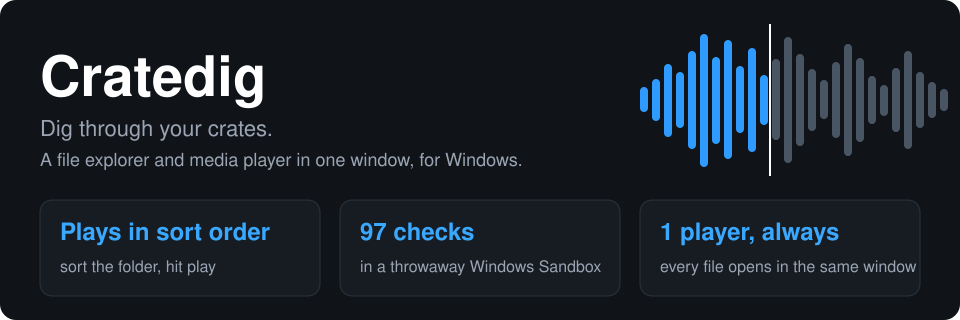
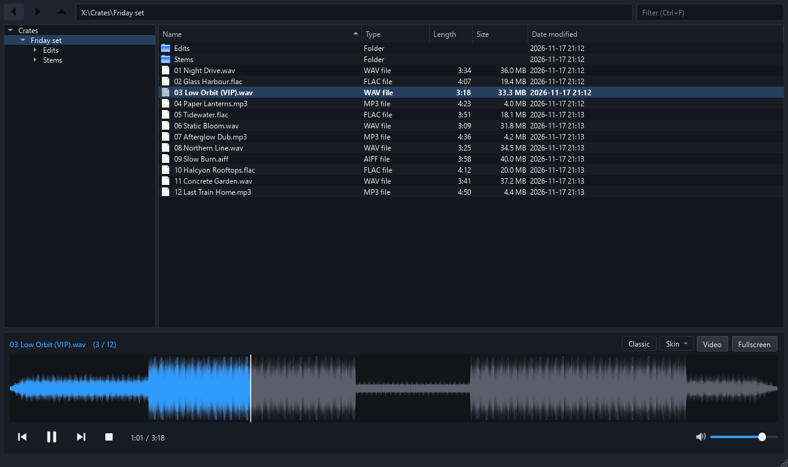
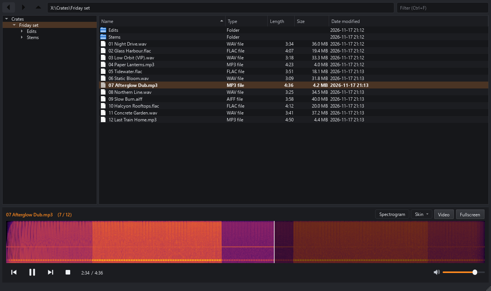
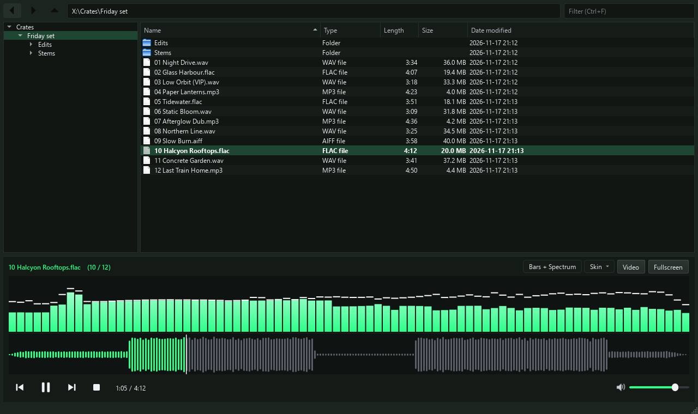

<p align="center">
  <a href="https://github.com/AARROWdev/cratedig/releases/latest">
    <picture>
      <source media="(prefers-color-scheme: dark)" srcset="docs/hero-dark.svg">
      <source media="(prefers-color-scheme: light)" srcset="docs/hero-light.svg">
      
    </picture>
  </a>
</p>

# Cratedig

**Download: [latest release](https://github.com/AARROWdev/cratedig/releases/latest)** (Windows 10/11, 64-bit)

Browse your folders like Explorer, sort them however you want, and hit play: everything in the view plays in that order. Built for digging through crates of WAVs, masters, stems and video clips without bouncing between Explorer and a player.



| Spectrogram (Ember skin) | Bars + Spectrum (Neon skin) |
|---|---|
|  |  |

## Download
From the [latest release](https://github.com/AARROWdev/cratedig/releases/latest):
- **CratedigSetup-&lt;version&gt;.exe** (recommended): installs to Program Files with a Start Menu entry and adds Cratedig to **Open with** for every audio and video type it plays. Run it again to upgrade; it closes Cratedig if it's open.
- **Cratedig-&lt;version&gt;-portable-win64.zip**: unzip anywhere and run `Cratedig.exe`. Nothing is installed.

The video engine (mpv) and the waveform engine (ffmpeg) are bundled. The app isn't code-signed yet, so Windows may show "Windows protected your PC": click **More info**, then **Run anyway**.

**Make it your default player:** Settings > Apps > Default apps > Cratedig, then pick the file types. (Windows only lets you do that yourself; the installer never takes over.)

**Uninstall:** Settings > Apps > Cratedig > Uninstall (portable: delete the folder). It removes the Open with entries too. Your settings stay in the registry (`HKCU\Software\Cratedig`) and the waveform cache in `%LOCALAPPDATA%\Cratedig`; delete those to remove them too.

## What it does
### Explorer
- Folder tree on the left, big file list in the middle
- Shows folders and the audio/video files it can play; other files (images, project files, text) are hidden
- Columns: **name, type, length, size, date**. Click one to sort; folders always stay on top.
- **Length** of every audio and video file, filled in on a background thread so the window never waits
- Names sort like Explorer, so `Track 2` comes before `Track 10`
- **Filter as you type** (Ctrl+F), back / forward / up, editable address bar (Ctrl+L)
- Right-click: Play from here, Show in Explorer, Copy Full Path

### Player
- **Plays in sort order:** double-click any file and the whole view queues from there, in the order you sorted it
- **One player, always:** open a file from Explorer while Cratedig is open and it plays in the same window
- Audio and video: WAV, FLAC, AIFF, MP3, M4A, OGG, OPUS, WMA, MP4, MKV, MOV, WEBM, AVI and more
- Gapless audio; a broken file is skipped instead of stopping the queue

### Playlists
- A **Playlists** panel under the folder tree: click one to see its tracks in the big list, with the same columns
- **Drag files** from the list onto a playlist to add them, or into an open playlist at any spot; drag inside a playlist to reorder
- **+** adds files to the selected playlist through a file picker; **New** makes a playlist
- Right-click a playlist: Play, Add files..., Rename, Duplicate, Export as .m3u8, **Copy files to folder** (e.g. a USB stick; never overwrites), Delete (to the Recycle Bin)
- In a playlist: Remove from playlist (Delete key; the file stays on disk), Show in Explorer, Copy Full Path
- Saved as plain `.m3u8` files in `Music\Cratedig Playlists`, so other players open them too. A file that was moved or deleted shows greyed out and is skipped.

### Compact player
While audio plays, **COMPACT** shrinks Cratedig to a small player: now playing, waveform, transport and volume. **FULL** (or Esc) brings the explorer back. It remembers the compact size, and a video brings the full window back by itself.

### Waveform panel (6 views, press W to cycle)
| View | What you see |
|---|---|
| **Classic** | Full-track waveform; solid core = loudness, faint edge = peaks, so drops and breakdowns stand out |
| **Bars** | Track map as bars, scaled to the track's loudest moment |
| **Spectrum** | Live frequency bars bouncing to the music |
| **Bars + Spectrum** | Live spectrum on top, track map underneath |
| **Spectrogram** | Frequency over time as a heat map: sub-bass, drops and hats at a glance |
| **Stereo** | Left and right channels stacked |

Click or drag anywhere on the panel to seek. Waveforms are analyzed in the background on first play and cached, so they're instant after that.

### Video
- **Smart layout:** vertical 9:16 videos play in a tall column on the right; 16:9 and square play above the list
- **Fullscreen** for any video: F (or F11), Esc to come back
- The Video and Fullscreen buttons show while a video plays; for audio you get COMPACT instead

### Skins
**Blue** (default), **Ember**, **Neon**, **Violet**, **Crimson**: the Skin button recolors the whole app, including the spectrogram.

| Key | Action |
|---|---|
| Enter / double-click | Open folder or play |
| Space | Play / pause |
| Backspace | Up a folder (or back from a playlist) |
| Delete | Remove the selected tracks from the open playlist |
| Alt+Left / Alt+Right | Back / forward |
| Ctrl+F / Esc | Filter / clear it |
| Ctrl+L | Type a path |
| Ctrl+Left / Ctrl+Right | Previous / next track |
| Shift+Left / Shift+Right | Seek -10 s / +10 s |
| W | Cycle waveform view |
| V | Show / hide video |
| F or F11 | Fullscreen (Esc exits) |
| Esc | Leave fullscreen or the compact player |

Cratedig remembers your last folder, window size, column layout, volume, view and skin. It never changes, moves or deletes your media.

## Tested in a throwaway Windows
`tests/` holds 155 automated checks that run inside a fresh Windows Sandbox, so nothing on a real PC is touched. Test media is generated in the Sandbox with ffmpeg: 14 common audio and video types, portrait and landscape video, video without audio, corrupt and empty files.

- **Installer, against the installed app:** install, Open with entries, upgrade while Cratedig is running, uninstall refused while it runs, clean uninstall (Open with entries gone, settings kept), portable zip
- **Single instance:** five rapid launches from Windows all hand their file to the one open window
- **Length column:** every tested type within 1 second of the real length; 2,000 files fill in without the window stalling
- **Playback:** sort order, next/prev/seek/pause/stop, corrupt files skipped, all 6 waveform views, the video layouts and fullscreen, high DPI at 100/150/200 %
- **Robustness:** a random click-and-key monkey test (4,500 steps during playback) that fails if the window stops responding for 2 seconds, folders deleted out from under the window, garbage settings
- **Never writes to your media:** every test file is hashed before and after the whole run

Release bar: every check passes **3 full runs in a row**. Getting there found 4 real bugs (Esc not clearing the filter, a bad setting crashing startup, typing `C:` opening the wrong folder, uninstall leaving a registry key). A separate AI code review then checked the code against a written spec over 4 passes and found 37 more, 14 of them serious: several files opened at once from Explorer starting several players, an `ffmpeg.exe` planted in a music folder getting run, crashes on unusual file names and dates, and the filter failing on any space. All fixed; most have a regression test. Version 1.2 (compact player, playlists) took 13 more review passes and 50 more findings, among them playlist lines from other players being rewritten on save, a freeze when dragging files from an offline network share, and a failed playlist save going unseen.

## Build
```
python -m venv .venv
.venv\Scripts\python -m pip install -r requirements.txt pyinstaller
winget install Gyan.FFmpeg            # bundled into the build
winget install JRSoftware.InnoSetup   # installer compiler
.\build.ps1   # -> dist\CratedigSetup-<ver>.exe, dist\Cratedig-<ver>-portable-win64.zip
```
Put `libmpv-2.dll` in a `lib\` folder first (from an mpv dev build, e.g. shinchiro's `mpv-dev-x86_64-*.7z`). `Cratedig.bat` runs it from source. `tests\sandbox\run-tests.ps1` runs the full suite in a fresh Windows Sandbox.

## How it was built
Python and PySide6 (Qt 6), playback by libmpv, analysis by ffmpeg. Built with [Claude Code](https://claude.com/claude-code): a written spec of what must work and what counts as a bug, a separate AI reviewer session checking every change against it until zero findings, and the Sandbox suite above as the release gate.

## License
[GPL-3.0](LICENSE). Cratedig bundles [mpv](https://mpv.io) and [FFmpeg](https://ffmpeg.org), which are GPL-licensed.

## Later
- More media columns: artist, title, bitrate, sample rate, BPM, key
- Deep indexed search across drives with filters like `type:wav bpm:170-176 date:2026`
- A/B loop, quick preview without touching the queue, crossfade
